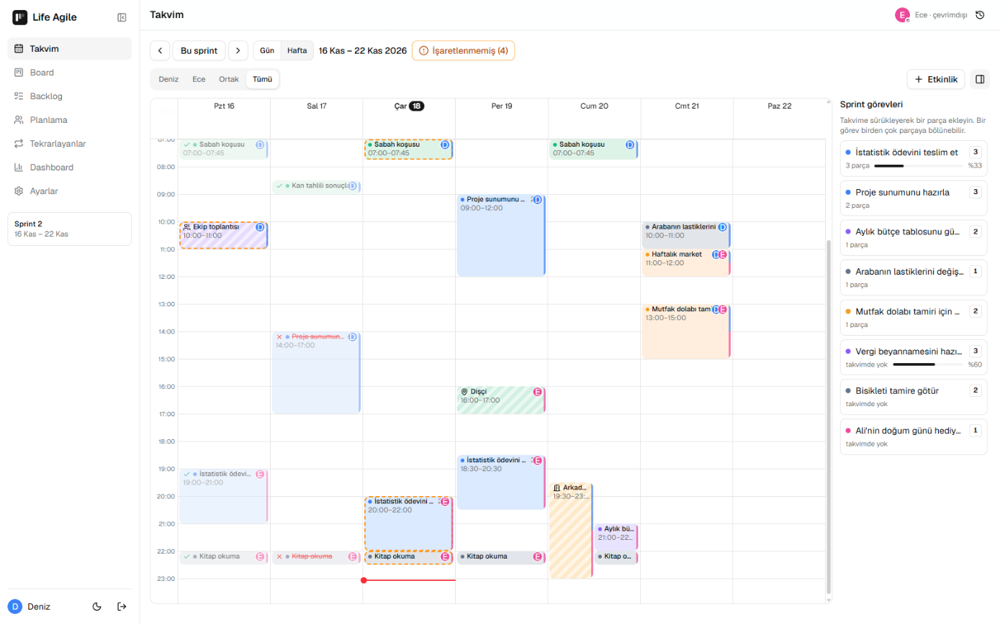
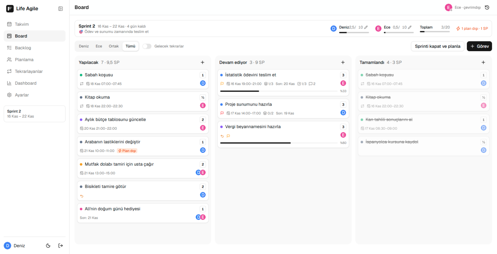
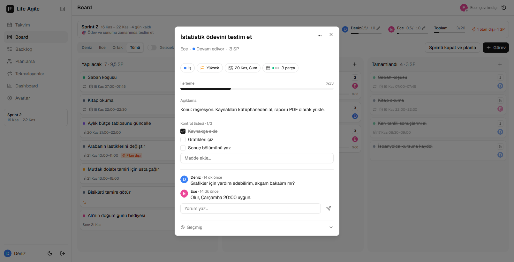
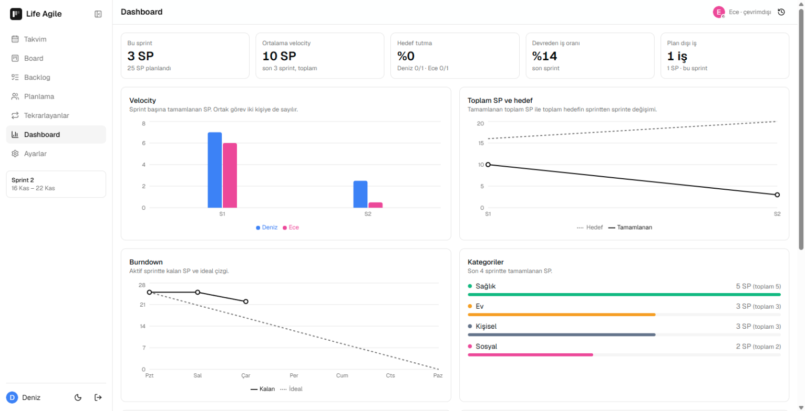
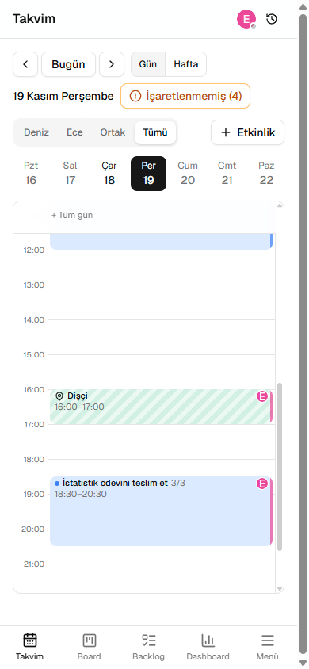
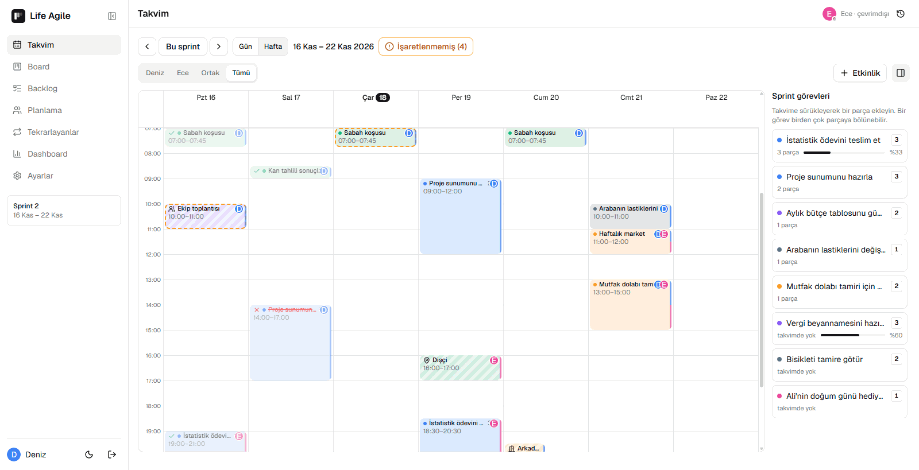

# Life Agile

**Plan your life in weekly sprints, together.**

Life Agile is a small, self-hosted agile board for a couple or a few people who share a home. You plan the week on Sunday, put tasks on a shared calendar, mark what you did, and look back in a short retro. The interface is in **Turkish**.



## Features

- **Weekly sprints** with a guided planning wizard: retro → grooming → estimation → start. Unfinished work carries over.
- **Shared calendar**: drag tasks onto the week, split big tasks into parts, mark each part done or missed. Events (meetings, guests, away) sit next to tasks.
- **Board and backlog**: to do / in progress / done, story points (0, ½, 1–5), categories, priorities, due dates, checklists, comments and a change history for every task.
- **Recurring tasks**: daily, weekdays or chosen weekdays; they appear in every sprint by themselves.
- **Dashboard**: velocity, target hit rate, carry-over, streaks of recurring tasks.
- **Live**: changes show up at once for everyone (SSE), with "who is looking at what".
- **Push reminders** (Web Push) and an installable app (PWA) for phones.
- **Simple accounts**: email + password, optional Google login, invite links. No email server needed.
- **Small and private**: one Docker container, one SQLite file, daily backups. Your data stays on your machine.

| Board | Task |
|---|---|
|  |  |
| **Dashboard** | **Phone** |
|  |  |

Open a part on the calendar, mark it done, and the task and its progress update for both of you:



## Quick start

You need [Docker](https://docs.docker.com/get-docker/) with Docker Compose.

```bash
git clone https://github.com/okaldev/life-agile.git && cd life-agile && docker compose up -d --build
```

Open <http://localhost:8080>. The first visit opens the setup page: create your account (you become the admin). Then go to **Ayarlar → Kişiler** to create an invite link for your partner and send it to them.

## Configuration

Everything works without configuration. To change something, copy `.env.example` to `.env`, edit it, and run `docker compose up -d` again.

| Variable | Default | What it does |
|---|---|---|
| `PUBLIC_URL` | the address you open | Your public address, e.g. `https://agile.example.com`. Needed for Google login, invite links and secure cookies. |
| `HOST_PORT` | `8080` | Port on your machine. |
| `APP_TIMEZONE` | `Europe/Istanbul` | Time zone for days, sprints and reminders. |
| `GOOGLE_CLIENT_ID`, `GOOGLE_CLIENT_SECRET` | off | Turns on "Google ile giriş yap". Create an OAuth client in Google Cloud with the redirect URI `PUBLIC_URL/auth/google/callback`. |
| `ALLOWED_EMAILS` | empty | Accounts to create at start (`email:Name,…`). |
| `VAPID_*` | created in `data/` | Web Push keys. |
| `HOLIDAYS` | `TR` | Public holidays on the calendars (`TR` or `none`). |

To put it on the internet, run it behind a reverse proxy with HTTPS (Caddy, Traefik, nginx) and set `PUBLIC_URL`. See [openwiki/deploy.md](openwiki/deploy.md).

## Data and backups

All data is in `./data`: the database `agile.db`, daily backups in `data/backups/` (30 days), and the push keys. Copy this folder to back up or to move the app. Updates:

```bash
git pull && docker compose up -d --build
```

Database changes run by themselves at start and never remove data.

## Development

Node.js 24+ is needed (TypeScript runs without a build step).

```bash
npm install && npm --prefix web install
npm run demo:seed && npm run demo     # sample data on http://localhost:8080 (log in as Deniz or Ece)
DEV_LOGIN=1 node --watch server/src/index.ts
npm --prefix web run dev              # UI with hot reload on :4321
npm test
```

Stack: Node 24, [Hono](https://hono.dev), built-in `node:sqlite`, [Astro](https://astro.build) + React, Tailwind CSS and [shadcn/ui](https://ui.shadcn.com). The design notes are in [openwiki/](openwiki/index.md).

## License

Life Agile is dual-licensed:

- **[AGPL-3.0](LICENSE)**: free to use, change and share. If you run a changed version for other people over a network, you must share its source code.
- **Commercial license**: for businesses that want to use it without the AGPL-3.0 duties. See [COMMERCIAL.md](COMMERCIAL.md) or email [furkancan@okal.dev](mailto:furkancan@okal.dev).
